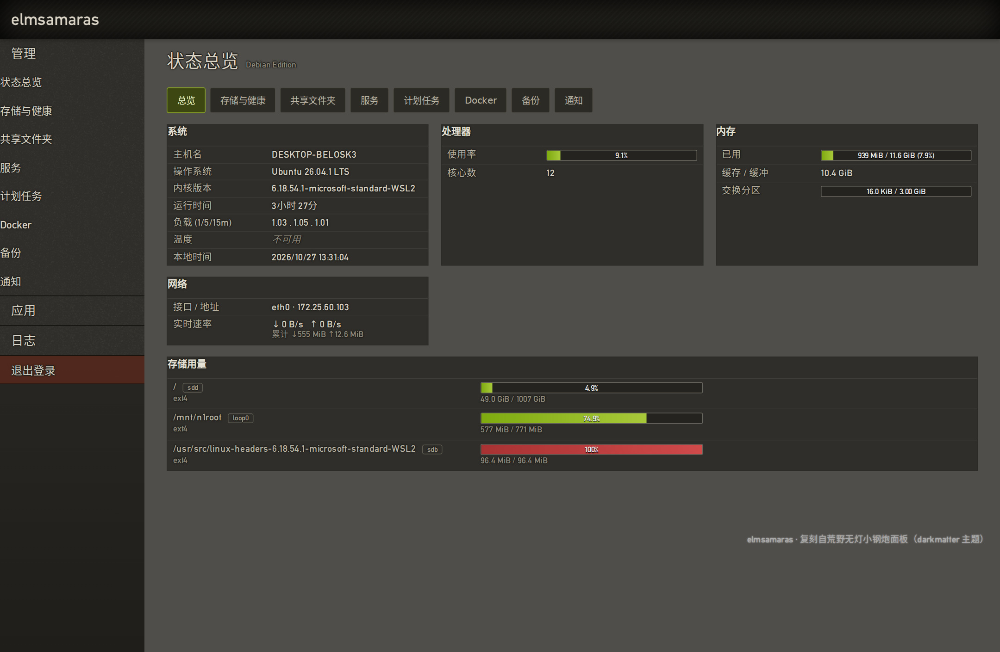
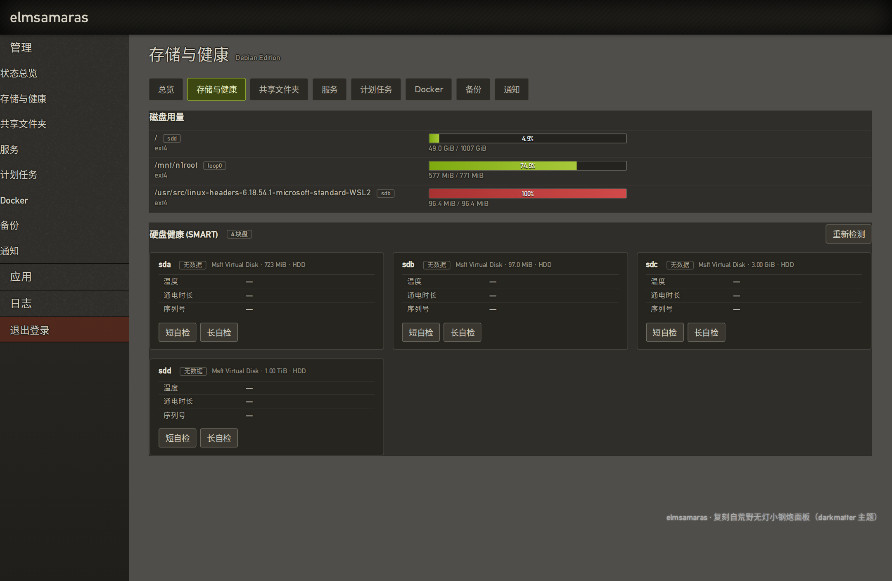
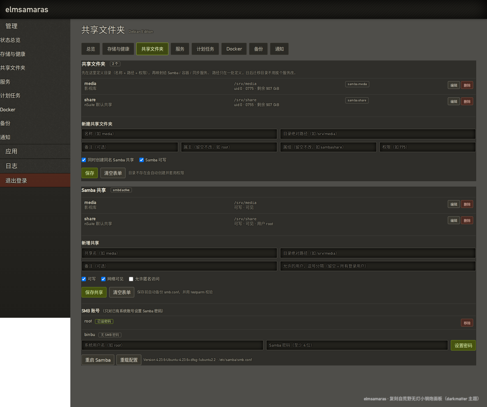
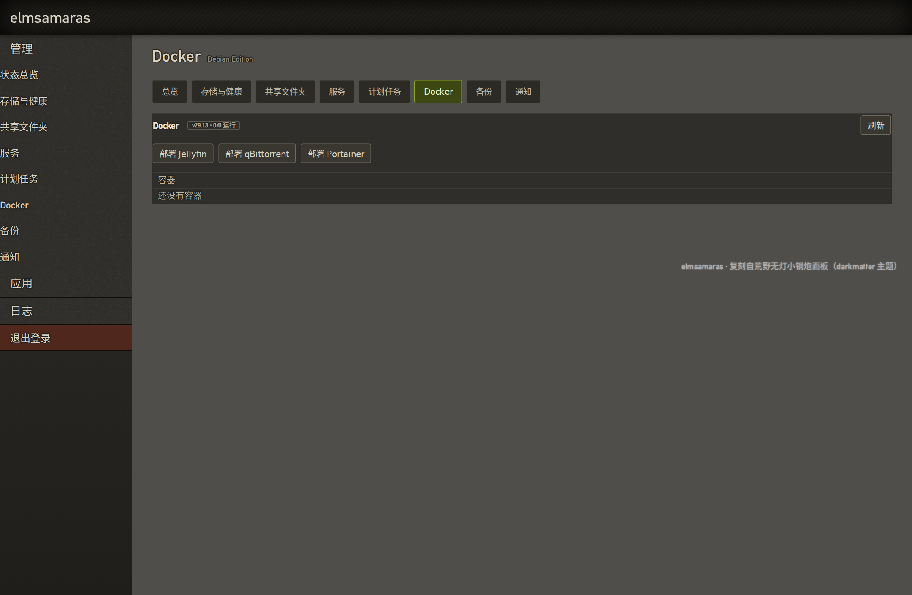
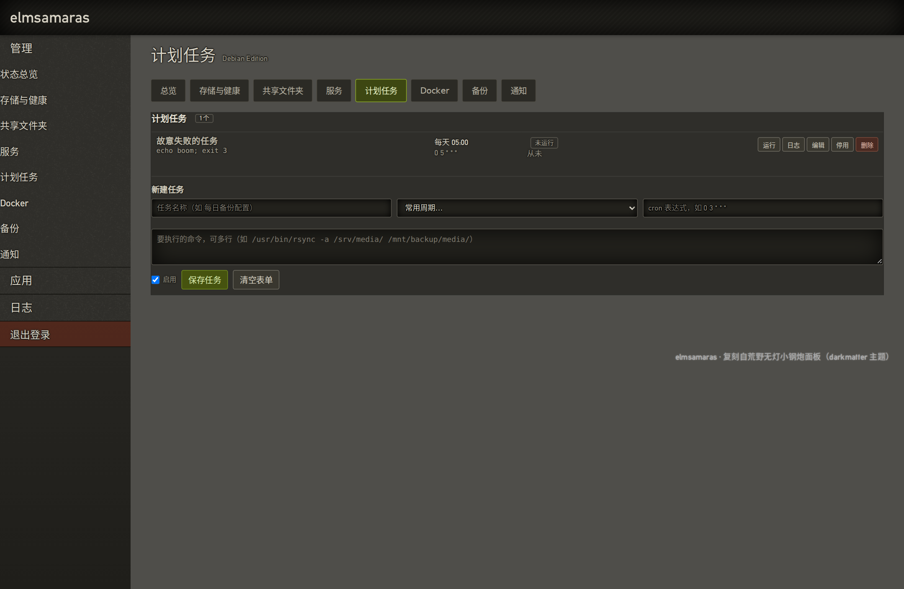
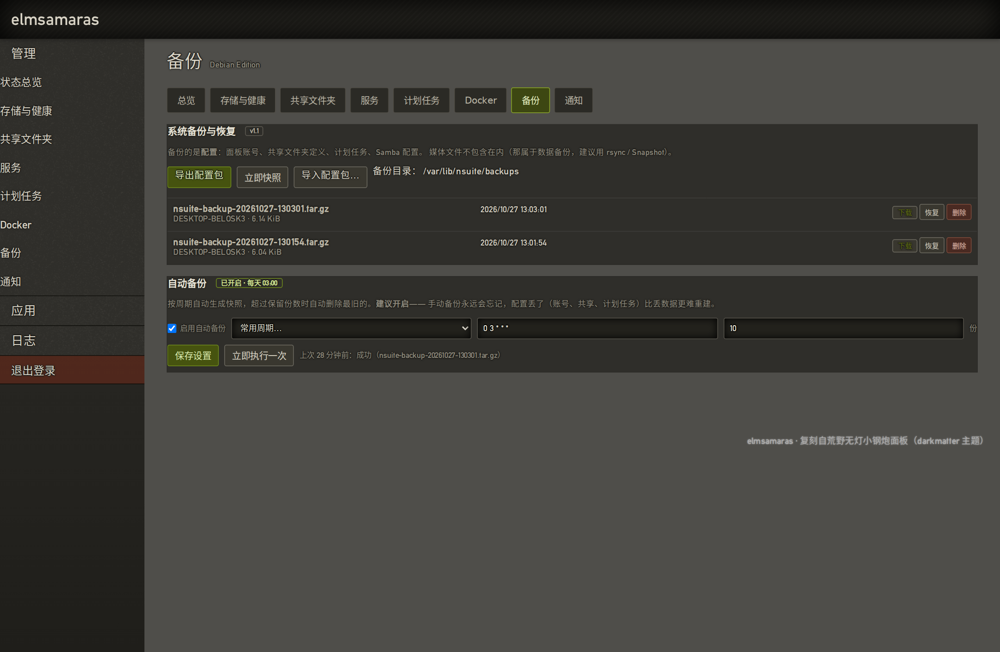
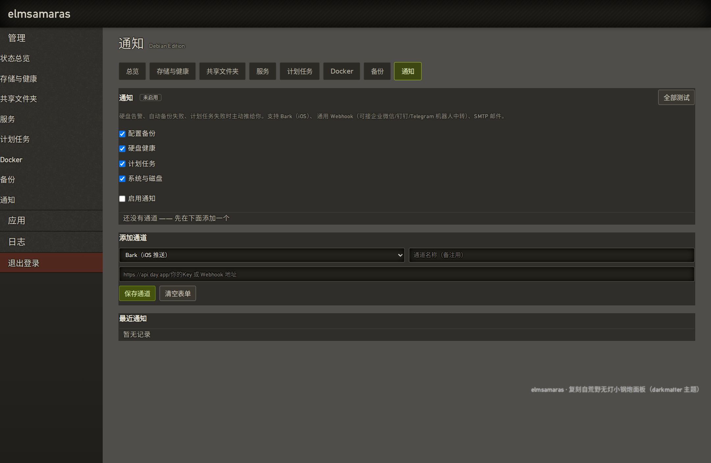
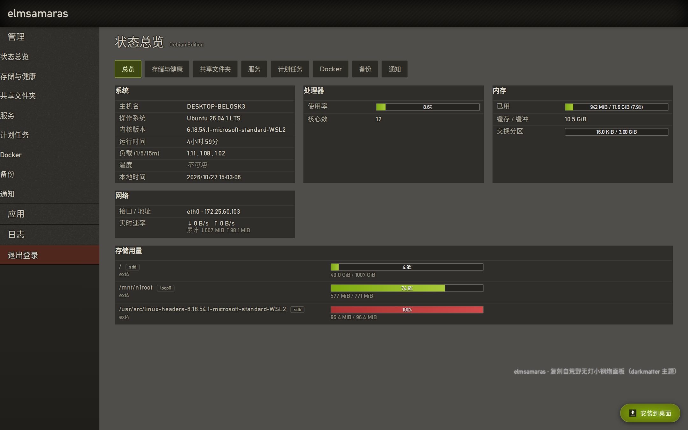
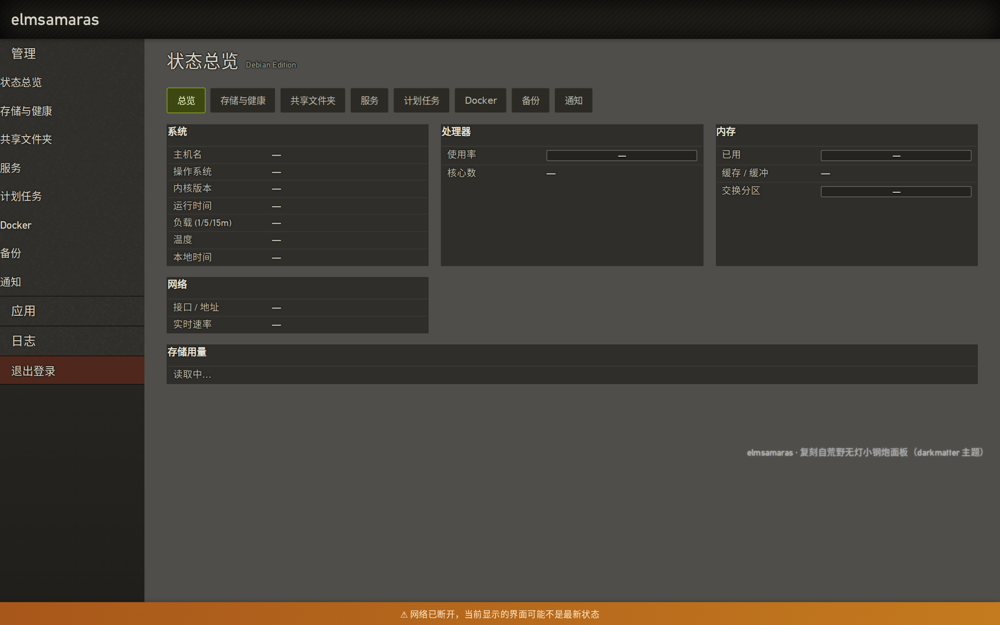

# elmsamaras — 轻量 NAS / 下载套件（Debian Edition）

把荒野无灯 N1「小钢炮」的 All-in-One 下载/NAS 体验，移植成 **Debian/Ubuntu 上可一键安装的套件**——类似 OpenMediaVault 的安装方式，但保持小钢炮的轻量（面板纯 Python 标准库，无 Web 框架依赖）。

内置能力：**Samba 管理 · 硬盘健康（SMART）· 共享文件夹抽象 · 计划任务 · Docker 可视化 · 配置备份 · 告警通知**。

## 界面预览

| 状态总览 | 存储与健康 |
|---|---|
|  |  |

| 共享文件夹 | Docker |
|---|---|
|  |  |

| 计划任务 | 备份与自动快照 |
|---|---|
|  |  |



PWA（可安装到桌面 / 手机主屏）：

| 安装按钮 | 断网提示 | 离线页 |
|---|---|---|
|  |  |  |

## 快速开始

### 一条命令安装（推荐）

任意 Debian 11 / 12 / **13**、Ubuntu 22.04 / 24.04 机器，root 执行：

```sh
curl -fsSL https://github.com/ubui/elmsamaras/releases/latest/download/get.sh | sudo bash
```

连 Docker + Portainer + Jellyfin + qBittorrent 一起装：

```sh
curl -fsSL https://github.com/ubui/elmsamaras/releases/latest/download/get.sh | sudo bash -s -- --full
```

引导器会自动装 curl、下载源码包、解压、把后续参数原样交给 `install.sh`。**重复执行即升级**，不会重置密码与配置。

### 局域网自建源（离线 / 内网）

装好一台之后，它本身就是安装源，其余机器不必再出网：

```sh
curl -fsSL http://<已装的机器IP>:8090/get.sh | sudo bash
curl -fsSL http://<已装的机器IP>:8090/get.sh | sudo bash -s -- --full
```

### 离线安装（单文件，源码内嵌）

```sh
curl -fsSLO https://github.com/ubui/elmsamaras/releases/latest/download/elmsamaras-1.3.0-install.sh
chmod +x elmsamaras-1.3.0-install.sh && sudo ./elmsamaras-1.3.0-install.sh
```

整个套件（6.2 MB）就在这一个文件里，拷到没有网络的机器上也能装。

### 源码目录安装

```sh
sudo ./install.sh                 # 面板 + Samba + SMART（轻量）
sudo ./install.sh --full          # 上面全部 + Docker + Portainer + Jellyfin + qBittorrent
sudo ./install.sh --full --docker-mirror https://docker.m.daocloud.io
                                  # 国内网络拉不到镜像时，先配好镜像加速
sudo ./install.sh --with aria2,transmission-daemon,nfs-kernel-server   # 追加组件
sudo ./install.sh --without-samba # 不装 Samba
sudo ./install.sh --port 8080     # 自定义端口
NSUITE_BRAND="我的NAS" sudo -E ./install.sh   # 安装时自定义面板显示名
```

### 其它管道用法

```sh
# 不用引导器，直接让 install.sh 自己去下载
curl -fsSL https://github.com/ubui/elmsamaras/releases/latest/download/install.sh | sudo bash
# 指定任意源码包（自建镜像 / 本地文件均可）
curl -fsSL https://github.com/ubui/elmsamaras/releases/latest/download/install.sh \
  | sudo bash -s -- --from https://example.com/elmsamaras-1.3.0.tar.gz
```

安装完成后访问 `http://<机器IP>:8090`，默认账号 **root / root**（`/etc/nsuite/passwd`）。再次运行安装脚本属于升级，**不会重置你已改过的密码，也不动 SMB 账号与既有共享配置**。

```sh
sudo python3 /opt/nsuite/nsuite/auth_cli.py /etc/nsuite/passwd root 新密码
```

`--full` 部署的容器：

| 容器 | 镜像 | 端口 | 说明 |
|---|---|---|---|
| Portainer | `portainer/portainer-ce` | 9000 / 9443 | Docker 图形化管理（面板有直达入口） |
| Jellyfin | `nyanmisaka/jellyfin` | 8096 | 媒体中心（国内维护者版本，核显硬解；有 `/dev/dri` 时自动挂载） |
| qBittorrent | `lscr.io/linuxserver/qbittorrent` | 8083 / 6881 | BT/PT 下载（初始 admin / adminadmin） |

数据目录：`/srv/jellyfin/{config,cache}`、`/srv/qbittorrent/config`、媒体库 `/srv/media`、下载 `/srv/downloads`。

## 面板功能（八个分区）

1. **状态总览**：CPU / 内存 / 交换分区 / 负载 / 温度 / 运行时间 / 实时网速 / 磁盘用量
2. **存储与健康**：挂载点用量 + **SMART 硬盘健康卡片**（健康结论、温度、通电时长、重映射/待映射/CRC 等关键属性、NVMe 寿命，一键短自检/长自检；USB 盘自动尝试 `-d sat`）
3. **共享文件夹**：OMV 式抽象——先定义目录（名称/路径/属主/权限），再映射给服务；Samba 引用关系按路径实时比对显示；可勾选"同时创建同名 Samba 共享"
4. **服务**：systemd 服务 + Docker 容器统一列表（状态灯、启停、应用直达）
5. **计划任务**：cron 的可视化（预设周期、cron 表达式、多行命令、立即运行、最近输出与退出码；`/etc/cron.d/nsuite` 自动生成）
6. **Docker**：容器/镜像列表、启停重启、日志查看、**一键部署** Portainer / Jellyfin / qBittorrent、Portainer 直达
7. **备份**：配置打包导出（tar.gz：面板账号 + 共享文件夹 + 计划任务 + Samba 配置）、导入（路径白名单校验，导入前自动快照）、本地快照管理；**自动备份**（按 cron 周期自动快照，超过保留份数自动删旧，失败即通知）
8. **通知**：Bark（iOS 推送）/ 通用 Webhook / SMTP 邮件三种通道，可多通道并行；按事件开关（备份、硬盘、计划任务、系统与磁盘）；通道级"测试"按钮 + 最近 20 条发送记录。后台每 30 分钟巡检硬盘健康与磁盘用量，同类告警 24 小时内只推一次

另有：日志页（journalctl 系统日志 / 内核日志）；**右上角应用直达按钮**（原版 NDM 同款）——已安装且有 WebUI 的应用常驻显示，运行中绿色、停止时灰色，悬停看说明，点击直达原生界面；手机上自动缩为状态色块。**PWA**：可安装到电脑桌面 / 手机主屏（独立窗口、无地址栏、自己的图标），断网时显示缓存外壳 + 底部提示条，恢复后自动消失；`manifest` 按品牌名动态生成，改名后应用名同步。

## 实现要点

- **Samba**：直接读写 `smb.conf` 目标段（注释与其余配置原样保留），每次修改自动备份（保留 30 份）→ `testparm` 校验 → `smbcontrol` 热加载；SMB 账号走 `smbpasswd`
- **计划任务**：每条命令落成 `/etc/nsuite/cron-jobs/<id>.sh`（避开 crontab 的 `%`/引号转义问题），由 `/usr/local/sbin/nsuite-cron-run` 包裹执行并记录退出码与最近 8KB 输出；停用任务即刻从 cron.d 移除
- **Docker**：走 docker CLI（不依赖 SDK / docker.sock Python 库），容器名白名单正则校验
- **备份导入**：逐条校验 tar 成员路径（拒绝绝对路径 / `..` / 符号链接），只允许落在 `etc/nsuite`、`etc/samba`、`etc/cron.d` 白名单内；逐文件覆盖而非删除目录（避免破坏 systemd 沙箱的挂载点）
- **自动备份**：配置存 `/etc/nsuite/backup.json`，cron 表由面板生成（`/etc/cron.d/nsuite-backup`），执行器 `backup_cli.py --auto` 独立于面板运行（面板挂了也能备份），结果写 `/var/lib/nsuite/backup-status.json`，失败立刻发通知
- **通知**：配置存 `/etc/nsuite/notify.json`（权限 600），全部标准库实现（`urllib` / `smtplib`）；发送是 best-effort，任何通道异常都不影响主流程；口令只写不读（接口返回 `has_password` 而非明文）
- **巡检**：`alerts.py` 后台线程每 30 分钟检查 SMART 与磁盘用量，用 `notify.once()` 做 24 小时去重，避免"硬盘有点小毛病"变成每小时一条推送
- **PWA**：`/manifest.webmanifest`（按 `[branding]` 动态生成）、`/sw.js`（根作用域 + `no-cache`，缓存版本跟随 `__version__`）与 `/offline` 均为认证前公开路由；图标由 `tools/make_pwa_icons.py` 纯标准库生成（深色底 + 橄榄绿 E，含 maskable 版）。Service Worker 策略：页面网络优先→缓存外壳→离线页；`/static/*` 先缓存后更新；`/api/*`、`/dist/*` 永不缓存（断网绝不吐旧数据）；登出时自动清掉页面缓存
- **升级**：安装脚本会把新版 `apps.json` 里新增的服务条目合并进现有清单（保留你的自定义），systemd → 容器承载的变更会自动同步；cron 执行器内容过期时自动重写
- **一条命令安装**：`install.sh` 有四层源码定位——当前目录 → 脚本尾部内嵌包 → `--from`/内置地址下载 → 明确报错提示。面板把 `/get.sh`、`/install.sh`、`/dist/*.tar.gz` 作为公开路由提供（安装包本身不含任何用户数据），并按请求 Host 自动注入下载地址，所以装上第一台后，整个局域网都能 `curl | sudo bash`。安装完成后由 `stage_dist()` 把当前版本的包放进 `/opt/nsuite/dist`，这台机器就成了可分发源；临时目录在退出时统一清理

## 目录结构

```
nsuite/
├── install.sh            一键安装（--full 含 Docker 全家桶；支持管道执行自举）
├── get.sh                一键安装引导器（curl ... | sudo bash 的入口）
├── uninstall.sh          卸载
├── etc/apps.json         默认服务清单（安装后位于 /etc/nsuite/apps.json）
├── nsuite/               面板后端（Python3 标准库）
│   ├── server.py         HTTP 路由 / 会话 / 全部 API
│   ├── metrics.py        /proc + /sys 指标采集（后台线程秒级采样）
│   ├── smart.py          SMART 硬盘健康（smartctl JSON 解析 + 短缓存）
│   ├── shares.py         共享文件夹抽象（定义 + 服务映射）
│   ├── samba.py          Samba 共享/账号管理
│   ├── cron.py           计划任务（定义、生成 cron.d、执行记录）
│   ├── dockerui.py       Docker 容器/镜像/日志/一键部署
│   ├── backup.py         配置导出/导入/快照（tar.gz + 路径白名单）+ 自动备份调度
│   ├── backup_cli.py     自动备份的 cron 入口（--auto）
│   ├── notify.py         通知通道（Bark / Webhook / SMTP）+ 去重与发送记录
│   ├── notify_cli.py     命令行发通知（计划任务失败时由执行器调用）
│   ├── alerts.py         后台巡检（硬盘健康 / 磁盘用量 → 告警）
│   ├── services.py       systemd + docker 双后端封装
│   └── auth.py           PBKDF2 口令（兼容旧 SHA-256 并自动升级）+ 内存会话 + 失败锁定
├── web/                  前端（darkmatter 主题 + 分区式动态面板）
└── screenshots/          实机截图
```

## 安全模型

- 登录：口令用 PBKDF2-HMAC-SHA256（12 万轮）加盐存储，文件权限 600；旧版的单轮 SHA-256 哈希仍可登录，并在登录成功时静默升级。Cookie 仅 HttpOnly + SameSite=Lax；同源 5 次失败锁 60 秒
- 服务控制：白名单 unit + 固定动作集；容器名/共享名/用户名/路径全部正则校验，防目录穿越
- 备份导入：tar 成员路径白名单（按原始成员名校验，`..`/绝对路径/链接文件一律拒绝）
- 通知口令：`notify.json` 权限 600，接口只回 `has_password`，不回明文；Webhook/Bark 地址限定 http(s)
- systemd 加固：`NoNewPrivileges` + `ProtectSystem=strict`，只放行 `/etc/nsuite`、`/etc/samba`、`/etc/cron.d`、`/var/lib/{nsuite,samba}`、`/srv`；`TMPDIR` 指向 `/var/lib/nsuite/tmp`（沙箱内 `/tmp` 只读）
- `[dev] allow_anonymous` 调试开关默认关闭，且仅在监听回环地址时生效
- 安装分发：`/get.sh`、`/install.sh`、`/dist/*` 匿名可读（内容是安装程序本身，不含账号/配置/数据）；`/dist/` 只接受 `elmsamaras-<版本>.(tar.gz|sh)` 形式的纯文件名，路径穿越与目录列举都被拒绝；Host 头做字符白名单后才用于拼下载地址

## 改名指南（自定义面板显示名）

显示名与内部代号（`nsuite`：目录/包名/服务单元名）是**解耦**的，改显示名不需要动任何代码：

1. **面板名称 / 登录页 / 浏览器标题**——唯一入口是 `/etc/nsuite/nsuite.conf`：

   ```ini
   [branding]
   title = 我的NAS        # 顶部栏、登录页、<title> 都用这个
   subtitle = Debian Edition
   ```

   改完执行 `sudo systemctl restart nsuite` 生效（刷新浏览器即可看到）。

2. **Samba 网络邻居里的描述字符串**——面板"重新初始化 Samba 配置"时会自动取 `branding.title` 写入 `smb.conf` 的 `server string`；已有配置想手改，直接编辑 `/etc/samba/smb.conf` 后 `sudo smbcontrol all reload-config`。

3. **systemd 服务描述**（`systemctl status` 里那行）——编辑 `/etc/systemd/system/nsuite.service` 的 `Description=`，然后 `sudo systemctl daemon-reload`。

4. **全新安装时一步到位**——`NSUITE_BRAND="我的NAS" sudo -E ./install.sh`。

不建议改内部代号 `nsuite`（路径 `/opt/nsuite`、`/etc/nsuite`、`/var/lib/nsuite`、包名、systemd 单元名都依赖它），改动需要全文替换并重装；显示名场景下完全没有必要。

## 发布新版本

仓库只放源码，安装包走 GitHub Release 资产（`dist/` 已被 `.gitignore` 排除）。发版步骤：

1. 改版本号：`nsuite/__init__.py` 的 `__version__`（面板 `--version`、分发源文件名都取它）
2. 打包出 `<ver>.tar.gz` 与自解压单文件 `<ver>-install.sh`
3. 建 Release，**5 个资产名字必须与下表一致**，否则 `releases/latest/download/...` 会断链

| 资产 | 用途 |
|---|---|
| `get.sh` | 一键安装入口（`curl … \| sudo bash`） |
| `install.sh` | 安装脚本本体（自带下载逻辑） |
| `elmsamaras.tar.gz` | **最新版固定别名**，`latest/download` 靠它指向当前版本 |
| `elmsamaras-<ver>.tar.gz` | 带版本号的源码包 |
| `elmsamaras-<ver>-install.sh` | 离线自解压单文件 |

```sh
gh release create v1.3.0 --repo ubui/elmsamaras --title "elmsamaras 1.3.0" \
  --notes-file notes.md \
  get.sh install.sh elmsamaras.tar.gz \
  elmsamaras-1.3.0.tar.gz elmsamaras-1.3.0-install.sh
```

安装脚本末尾的 `stage_dist()` 会把本次安装用的包放进 `/opt/nsuite/dist`，所以**装好的机器本身就是局域网分发源**，内网机器无需出网。

## 已知差异 / 局限

- 原版面板二进制闭源、混淆、带 RSA 签名校验和 Amlogic 硬件检查，无法在 x86 复用；本套件用同主题重写
- qBittorrent / Transmission 的细粒度配置请在各自原生 WebUI 完成
- WSL2 / 虚拟机的虚拟磁盘没有 SMART 数据，对应卡片显示"无数据"属正常
- Docker Hub 直连超时的网络请用 `--docker-mirror`（如 `https://docker.m.daocloud.io`）
- Debian 自带的 `smb.conf` 里有 `disable netbios = yes`，因此 `nmbd` 会被 systemd 的 `ExecCondition` 跳过（`is-active` 显示 inactive 属正常）。不影响 `\\IP\share` 访问，只影响"网络邻居里按机器名发现"；需要按名字发现时把该行改 `no` 并 `systemctl restart nmbd`
- 通知不做重试队列：某次推送失败时详情留在面板"最近通知"里，不会补发历史消息（但硬盘/磁盘告警在发送失败时会撤销去重标记，下一轮巡检会再试）
- 自动备份只备份**配置**（几百 KB），媒体文件请用 rsync / 快照方案
- PWA 的 Service Worker 只在安全上下文生效：`https` 或 `http://localhost` / `http://127.0.0.1`。用局域网 IP 走 HTTP 访问时，浏览器会跳过 SW（离线外壳与"安装"提示不可用），但 manifest 与 Apple meta 仍然生效——iPhone Safari 的"添加到主屏幕"以独立窗口打开不受影响；需要完整 PWA 体验时给面板配 HTTPS 反代（或经 SSH 隧道用 localhost 访问）
